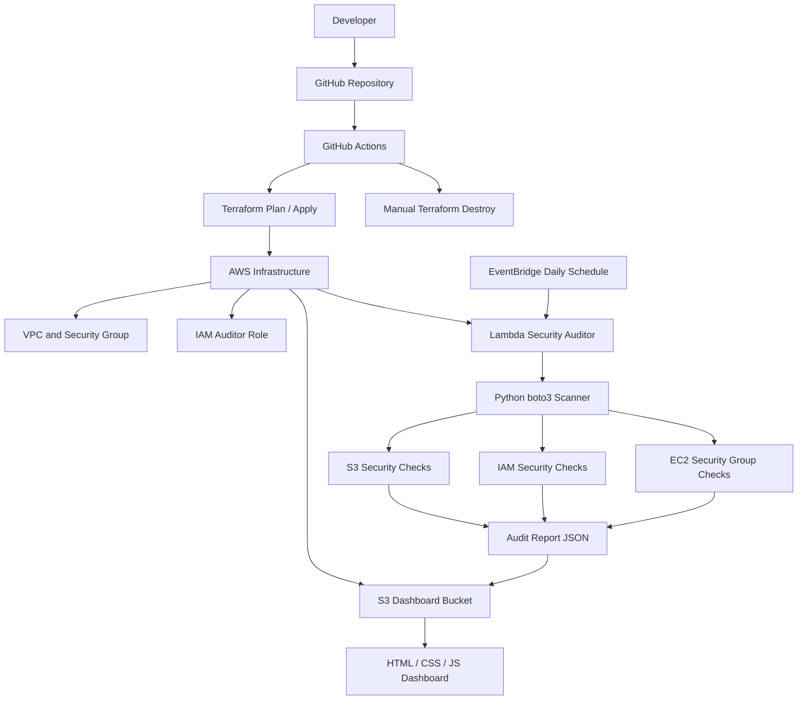

# 🛡️ CloudGuard-IaC — AWS Infrastructure Provisioning & Security Compliance Auditor

An Infrastructure-as-Code and cloud security automation platform that provisions AWS resources using Terraform, audits cloud security configurations using Python and boto3, and visualizes compliance results through an interactive web dashboard.

Built using **Terraform, AWS, Python, boto3, S3, IAM, AWS Lambda, EventBridge, HTML, CSS, JavaScript, and GitHub Actions**.

## 📌 Project Overview

Cloud environments can become difficult to manage consistently as resources are created, modified, and removed. Misconfigured S3 buckets, excessive IAM permissions, outdated access keys, missing MFA, and unrestricted SSH access can expose cloud resources to security risks.

CloudGuard-IaC addresses these challenges through two major capabilities:

1. **Infrastructure Provisioning:** Uses Terraform to provision and manage AWS infrastructure through Infrastructure as Code.
2. **Security Compliance Auditing:** Uses Python and boto3 to inspect AWS resources, identify security misconfigurations, and generate automated compliance reports.

GitHub Actions automates infrastructure validation, deployment, security auditing, and resource teardown.

## 🎯 Key Features

- **Infrastructure as Code:** Provision AWS resources using Terraform.
- **Automated AWS Provisioning:** Create VPCs, subnets, security groups, S3 buckets, and IAM roles.
- **S3 Security Auditing:** Detect buckets missing Public Access Block settings or server-side encryption.
- **IAM Security Auditing:** Identify IAM users without MFA and access keys older than 90 days.
- **Network Security Auditing:** Detect security groups allowing unrestricted SSH access through `0.0.0.0/0`.
- **Python Automation:** Perform AWS security checks using boto3.
- **AWS Lambda Integration:** Execute security audits through a serverless Python function.
- **Scheduled Auditing:** Use Amazon EventBridge to trigger daily security scans.
- **Compliance Dashboard:** Display security findings using HTML, CSS, and JavaScript.
- **Automated CI/CD:** Use GitHub Actions for Terraform validation, deployment, and dashboard updates.
- **One-Click Teardown:** Trigger a manual Terraform destroy workflow to remove demonstration infrastructure.

## 🏗️ System Architecture



### System Components

| Component | Responsibility |
|---|---|
| Terraform | Infrastructure provisioning and management |
| AWS VPC | Network isolation |
| AWS Subnet | Network segmentation |
| Internet Gateway | Internet connectivity |
| Security Groups | Network traffic filtering |
| Amazon S3 | Dashboard hosting and audit report storage |
| AWS IAM | Identity and access management |
| AWS Lambda | Serverless security scanning |
| Amazon EventBridge | Scheduled audit execution |
| Python + boto3 | AWS security auditing |
| HTML, CSS, JavaScript | Compliance dashboard |
| GitHub Actions | Automated CI/CD pipeline |

## 🛠️ Technology Stack

| Category | Technologies |
|---|---|
| Infrastructure as Code | Terraform |
| Cloud Platform | Amazon Web Services |
| Cloud Region | Mumbai (`ap-south-1`) |
| Networking | VPC, Subnet, Internet Gateway, Security Groups |
| Storage | Amazon S3 |
| Identity Management | AWS IAM |
| Serverless Computing | AWS Lambda |
| Scheduling | Amazon EventBridge |
| Backend Automation | Python 3.11 |
| AWS SDK | boto3 |
| Frontend | HTML5, CSS3, JavaScript |
| CI/CD | GitHub Actions |
| Version Control | Git and GitHub |

## ⚙️ How the System Works

### 1. Infrastructure Provisioning with Terraform

Terraform defines and provisions the AWS infrastructure.

The infrastructure includes:

- Custom Virtual Private Cloud.
- Public subnet.
- Internet Gateway.
- Route table and routing configuration.
- Security group with restricted inbound access.
- S3 bucket for dashboard hosting.
- IAM role for the Lambda security auditor.
- AWS Lambda function.
- EventBridge scheduled trigger.

Terraform maintains the desired infrastructure configuration and tracks managed resources through its state file.

### 2. AWS Security Auditing with Python

The Python security auditor uses boto3 to inspect AWS resources.

**S3 Security Checks**

- Verify that all four S3 Public Access Block settings are enabled for buckets expected to remain private.
- Identify buckets without server-side encryption.
- Generate findings for potentially exposed storage resources.

**IAM Security Checks**

- Identify IAM users without MFA devices.
- Inspect IAM access-key creation dates.
- Flag active access keys older than 90 days.

**Security Group Checks**

- Inspect inbound security group permissions.
- Identify SSH access on TCP port 22.
- Detect unrestricted access from `0.0.0.0/0`.

The scanner uses read-only AWS permissions for inspection wherever possible.

### 3. Compliance Report Generation

The auditor combines security findings into a JSON report.

Example:

```json
{
  "scanned_at": "2026-11-23T10:00:00+00:00",
  "summary": {
    "total_checks": 3,
    "passed": 2,
    "failed": 1
  },
  "score": "2/3 Passed",
  "findings": [
    {
      "resource": "S3::example-bucket",
      "check": "Public Access Blocked",
      "status": "PASS",
      "severity": "INFO"
    },
    {
      "resource": "SG::sg-12345678",
      "check": "SSH Restricted",
      "status": "FAIL",
      "severity": "CRITICAL"
    }
  ]
}
```

The generated report is uploaded to the dashboard S3 bucket as:

```text
audit-report.json
```

### 4. Compliance Dashboard

The frontend dashboard retrieves the JSON report and displays security findings.

Dashboard components include:

- Overall AWS compliance score.
- Total security checks.
- Passed and failed checks.
- Critical, high, and medium severity findings.
- S3 bucket security status.
- IAM user security status.
- Security group exposure status.
- Last audit timestamp.
- Resource-level security findings.

### 5. Scheduled Security Auditing

AWS Lambda executes the Python security scanner.

Amazon EventBridge triggers the Lambda function automatically according to a configured schedule, such as once per day.

The scanner generates a new report and uploads it to S3, allowing the dashboard to display the latest audit results.

## 🔍 AWS Security Audit Modules

### A. S3 Security Auditor

Checks:

- Public Access Block configuration.
- Server-side encryption configuration.
- Potentially exposed buckets.

### B. IAM Security Auditor

Checks:

- Missing MFA devices.
- Active access keys older than 90 days.
- Access-key rotation compliance.

### C. EC2 Security Group Auditor

Checks:

- Unrestricted SSH access.
- Port 22 exposure.
- Inbound network permissions.

### Security Compliance Matrix

| AWS Service | Security Check | Failure Condition | Severity |
|---|---|---|---|
| S3 | Public Access Block | Required protection settings disabled | HIGH |
| S3 | Server-Side Encryption | Default encryption not configured | MEDIUM |
| IAM | MFA | User has no MFA device | HIGH |
| IAM | Access Key Rotation | Active key older than 90 days | MEDIUM |
| EC2 | SSH Exposure | Port 22 open to `0.0.0.0/0` | CRITICAL |

Audit errors caused by insufficient permissions should be reported separately rather than incorrectly marked as successful checks.

## 🧱 Terraform Infrastructure Design

Terraform manages the AWS infrastructure using reusable configuration files.

### Planned AWS Resources

| AWS Resource | Terraform Resource | Purpose |
|---|---|---|
| VPC | `aws_vpc` | Network isolation |
| Public Subnet | `aws_subnet` | Public network segment |
| Internet Gateway | `aws_internet_gateway` | Internet connectivity |
| Route Table | `aws_route_table` | Network routing |
| Security Group | `aws_security_group` | Traffic filtering |
| S3 Bucket | `aws_s3_bucket` | Dashboard hosting |
| IAM Role | `aws_iam_role` | Lambda execution identity |
| IAM Policy | `aws_iam_role_policy` | Least-privilege permissions |
| Lambda | `aws_lambda_function` | Security scanner |
| EventBridge Rule | `aws_cloudwatch_event_rule` | Scheduled auditing |

### Terraform Commands

Initialize Terraform:

```bash
terraform init
```

Format Terraform files:

```bash
terraform fmt -recursive
```

Validate configuration:

```bash
terraform validate
```

Preview infrastructure changes:

```bash
terraform plan
```

Provision AWS resources:

```bash
terraform apply
```

Destroy Terraform-managed infrastructure:

```bash
terraform destroy
```

Always review the Terraform plan before applying or destroying resources.

## 🔐 IAM Least-Privilege Security

The Lambda function uses an IAM execution role with permissions required for auditing.

Example permissions include:

- `s3:ListAllMyBuckets`
- `s3:GetBucketPublicAccessBlock`
- `s3:GetEncryptionConfiguration`
- `iam:ListUsers`
- `iam:ListMFADevices`
- `iam:ListAccessKeys`
- `ec2:DescribeSecurityGroups`
- `s3:PutObject` for the designated report bucket.
- Required CloudWatch Logs permissions.

The Lambda role must trust the AWS Lambda service:

```json
{
  "Version": "2012-10-17",
  "Statement": [
    {
      "Effect": "Allow",
      "Principal": {
        "Service": "lambda.amazonaws.com"
      },
      "Action": "sts:AssumeRole"
    }
  ]
}
```

Avoid broad permissions such as `s3:*`, `iam:*`, or `logs:*` when narrower permissions are sufficient.

## 📊 Security Compliance Dashboard

The dashboard is designed as a real-time-style AWS security scorecard.

### Dashboard Features

- Overall compliance percentage.
- Total audit checks.
- Passed security checks.
- Failed security checks.
- Critical security alerts.
- S3 configuration status.
- IAM security status.
- Network security status.
- Audit history and timestamps.

### Frontend Structure

```text
frontend/
├── index.html
├── style.css
├── app.js
└── audit-report.json
```

The frontend retrieves the generated audit report from the configured S3 location.

**Dashboard security consideration:** If the S3 bucket is configured for public static website hosting, that bucket is an intentional public-access exception. The auditor should identify it explicitly and continue enforcing private-bucket checks for other buckets. Do not weaken account-wide S3 protections just to host the dashboard.

## 🔄 CI/CD Pipeline

GitHub Actions automates infrastructure validation, deployment, auditing, and teardown.

### 1. Pull Request Workflow

When a pull request is opened:

1. Checkout the GitHub repository.
2. Set up Terraform.
3. Run Terraform formatting checks.
4. Initialize Terraform.
5. Validate Terraform configuration.
6. Generate a Terraform plan.
7. Publish the plan for review.

### 2. Main Branch Deployment

When changes are pushed to the main branch:

1. Checkout the repository.
2. Configure AWS credentials using GitHub OIDC.
3. Initialize and validate Terraform.
4. Apply the reviewed infrastructure configuration.
5. Package and deploy the Lambda function.
6. Upload frontend dashboard files to S3.
7. Execute or trigger a security audit.
8. Publish the updated compliance report.

### 3. Manual Terraform Destroy Workflow

A separate GitHub Actions workflow provides a manually triggered teardown option.

The workflow:

- Uses `workflow_dispatch`.
- Initializes Terraform.
- Reviews the destruction plan.
- Requests confirmation or approval.
- Executes Terraform destroy.
- Removes Terraform-managed demonstration infrastructure.

Protected environments and approval controls should be used to prevent accidental deletion.

### Workflow Structure

```text
.github/
└── workflows/
    ├── terraform-plan.yml
    ├── deploy.yml
    └── destroy.yml
```

## 💰 AWS Cost Optimization

CloudGuard-IaC is designed with cost awareness and short-lived demonstrations in mind.

Cost optimization practices:

- Prefer services and configurations that fit applicable AWS Free Tier allowances.
- Avoid unnecessary NAT Gateways and always-on compute.
- Use Lambda for serverless auditing.
- Schedule audits instead of running continuous workloads.
- Keep demonstration environments running only when necessary.
- Use Terraform destroy after demonstrations.
- Check for leftover resources, logs, and stored objects after teardown.

**Important:** AWS Free Tier eligibility and pricing depend on account age, service, region, usage, and current AWS pricing policies. This architecture does not guarantee a ₹0 bill. S3 hosting, storage, requests, data transfer, Lambda, logging, and other services may incur charges.

## 🔒 Security Best Practices

- Never commit AWS access keys or secret keys to GitHub.
- Prefer GitHub Actions OIDC federation over long-lived credentials.
- Store sensitive Terraform variables securely.
- Keep Terraform state files out of Git.
- Use encrypted and access-controlled remote state storage when appropriate.
- Follow least-privilege IAM policies.
- Restrict access to audit reports containing sensitive resource information.
- Publish only sanitized security findings on a public dashboard.
- Use HTTPS through an appropriate hosting configuration.
- Review Terraform plans before applying infrastructure changes.

## 📁 Repository Structure

```text
CloudGuard-IaC/
│
├── terraform/
│   ├── main.tf
│   ├── variables.tf
│   ├── outputs.tf
│   ├── providers.tf
│   └── versions.tf
│
├── auditor/
│   ├── scanner.py
│   ├── requirements.txt
│   └── tests/
│       └── test_scanner.py
│
├── lambda/
│   └── handler.py
│
├── frontend/
│   ├── index.html
│   ├── style.css
│   ├── app.js
│   └── audit-report.json
│
├── .github/
│   └── workflows/
│       ├── terraform-plan.yml
│       ├── deploy.yml
│       └── destroy.yml
│
├── .gitignore
└── README.md
```

## 🚀 Getting Started

### Prerequisites

Install the following tools:

- AWS Account.
- AWS CLI.
- Terraform.
- Python 3.11 or later.
- Git.
- GitHub account.

### Clone the Repository

```bash
git clone https://github.com/YOUR_USERNAME/CloudGuard-IaC.git
```

```bash
cd CloudGuard-IaC
```

### Configure AWS CLI

Configure your AWS credentials using an approved authentication method:

```bash
aws configure
```

Verify your AWS identity:

```bash
aws sts get-caller-identity
```

Never store AWS credentials directly in source files.

### Install Python Dependencies

Navigate to the auditor directory:

```bash
cd auditor
```

Create a virtual environment:

```bash
python3 -m venv .venv
```

Activate it on macOS or Linux:

```bash
source .venv/bin/activate
```

Install dependencies:

```bash
pip install -r requirements.txt
```

### Initialize Terraform

Navigate to the Terraform directory:

```bash
cd ../terraform
```

Initialize:

```bash
terraform init
```

Validate:

```bash
terraform validate
```

Preview infrastructure:

```bash
terraform plan
```

Review resource costs and security implications before provisioning AWS infrastructure.

## 🧪 Testing Strategy

### Terraform Testing

- Terraform formatting validation.
- Terraform initialization.
- Terraform configuration validation.
- Infrastructure plan review.
- IAM policy configuration checks.
- Security group exposure checks.

### Python Auditor Testing

- S3 buckets with all public access protections enabled.
- S3 buckets with missing public access protection.
- Buckets with and without encryption.
- IAM users with and without MFA.
- Active access keys older and newer than the configured threshold.
- Security groups with restricted and unrestricted SSH access.
- AWS API permission errors.

### Dashboard Testing

- Valid audit report loading.
- Compliance score calculation.
- Passed and failed findings display.
- Severity classification.
- Missing report handling.
- Invalid JSON handling.
- Audit timestamp display.

## 🎓 Project Objective

The primary objective of CloudGuard-IaC is to demonstrate how Infrastructure as Code, cloud security auditing, serverless automation, and CI/CD can work together to improve AWS infrastructure management and security visibility.

This project combines **Cloud Engineering, Infrastructure as Code, Python Automation, AWS Security, Serverless Computing, Frontend Development, and DevOps practices** in one practical cloud platform.

---

**Built with Terraform, AWS, Python, boto3, and GitHub Actions.**
